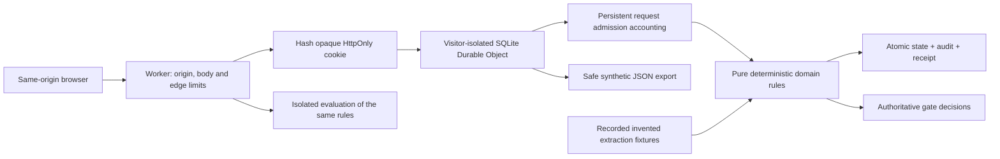

# Architecture and decisions

**Ayo Ahmed - Independent concept** · **Independent concept for Semble**

> Unofficial. Synthetic operational data only. Not connected to Semble. Not a clinical system or compliance certification.

## Boundary

`src/domain.mjs` owns validation, opportunity aggregation, gates, lifecycle, content-version binding, fixed-clock audit, idempotency semantics and safe export. `src/fixtures.mjs` holds invented sources and recorded extraction responses. `src/evaluation.mjs` executes actual scenarios against those same rules in fresh isolated states. `src/worker.mjs` adds HTTP validation, origin enforcement, random visitor sessions, actual security time, rate limits and SQLite persistence. The browser renders server gates and never owns authorization.

No live model, external notification, account integration, clinical record or arbitrary file ingestion exists. A release is a recorded simulation, never a code deployment. Domain audit uses a fixed simulation epoch plus revision minutes; cookie expiry and rate admission use real wall time. UI measurement is synthetic, not an observed business result.

## Visitor persistence

Session creation generates 256 random bits in a host-only HttpOnly cookie. Its SHA-256 digest names a Durable Object; raw tokens are not persisted or exported. Each object owns one SQLite session row containing workflow state and bounded security metadata. No product state is shared globally. Reads and edits reload persistent state, so reloads and Worker restarts retain a visitor's work until expiry. An alarm deletes session data at the six-hour expiry; expiry is also checked on every request.

Admission accounting commits in its own small transaction before JSON or domain validation. Rejected requests consume the same request budget as successful ones. Valid commands then commit domain state, audit event and content-bound receipt in a separate atomic SQLite transaction. A crash cannot produce a state change without its corresponding audit/receipt. Request counters may advance when a command fails; workflow revision does not. SQLite synchronous transactions do not await external work.

A preview only changes bounded security metadata: complete canonical accepted batch and revision. Commit must match this exact preview plus current revision. A short preview identifier is a UI handle, not the only authorization check. The domain revalidates all rows at commit, and any rejected row refuses the complete batch.

## Concurrency and replay

Every browser command includes the displayed revision and fresh idempotency key. Concurrent tabs cannot overwrite a newer version: new stale commands receive 409 with actual revision. An exact receipt replay returns its recorded result without another revision/audit event. Receipt keys bind the complete canonical command including expected revision; different content under the same key receives 409. Receipts are retained until bounded session expiry rather than silently evicted and accidentally permitting repeated commands.

The server never trusts a browser `ready` flag or an arbitrary extraction assertion. Gate readiness is derived from validated current state. Version changes clear corresponding signatures. Failed health preserves the owned rollback obligation and prohibits edits that would erase it; successful health cannot retrospectively cancel a failed result.

## Deployment fail closed

`wrangler.jsonc` is pure JSON. The committed `APP_ORIGIN` is empty and `LOCAL_DEV` is false, so its API cannot operate until an exact approved public HTTPS origin is configured. Public operation also requires `RATE_LIMIT_ENFORCED=true`, `SESSION_LIMITER` and `REQUEST_LIMITER` rate-limit bindings. The first protects creation; the second bounds all API traffic, including fabricated cookie-token lookups before a visitor exists. Both are Cloudflare infrastructure bindings with separate namespace IDs. Missing origin, binding or flag returns 503/403 rather than exposing an unprotected public demo.

The local development command supplies `LOCAL_DEV=true` and exact loopback origin. Only localhost/127.0.0.1/::1 can use that exception. When infrastructure bindings are absent, local-only metadata maps provide bounded per-minute creation/request protection; they hold hashed network buckets and counters, never workflow records. This fallback is per process and is not a production distributed limiter. Production always fails closed without its provisioned bindings.

Assets route through the Worker (`run_worker_first=true`) so CSP, frame denial, MIME protection, no-referrer and permissions policies apply in production as well as local tests. Asset fetching is read-only; API JSON is no-store. Scripts/styles/fonts are local assets with no external script or font service.

## Limits and trade-offs

The free prototype uses no paid runtime dependency. SQLite Durable Objects and Cloudflare's limiter bindings need compatible account support and destination approval; successful deployment and billing are not inferred from local tests. Authentication is visitor possession of a short-lived opaque cookie, not organizational user identity, RBAC or verified human signoff. Public visitors can create their own synthetic workspaces; there is no shared team collaboration or production compliance boundary.

Strict fixture matching trades general-purpose importing for inspectable evidence integrity. It proves refusal, grounding, deduplication and human review mechanics for the invented dataset; it does not claim robust arbitrary language understanding or adequate sensitive-data detection for real-world inputs. The synthetic policy is a workflow demonstration, with production study design, accessibility, regulatory, security and privacy review still required.

See [api-schema.md](api-schema.md) for commands and exact limits and [threat-privacy.md](threat-privacy.md) for boundaries and residual risks.
