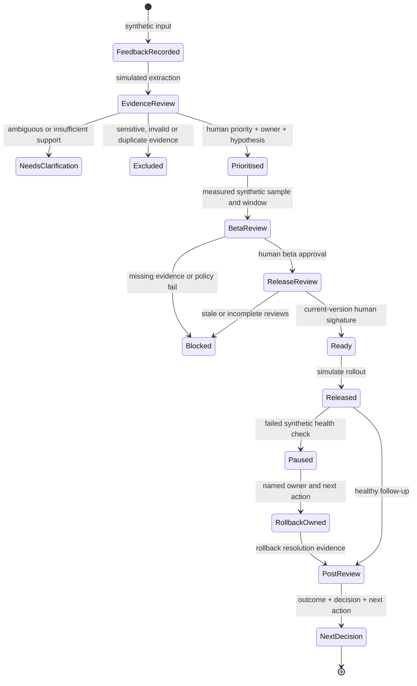

# Feedback → Release Proof: product requirements

**Ayo Ahmed - Independent concept** · **Independent concept for Semble**

> Unofficial. Synthetic operational data only. Not connected to Semble. Not a clinical system or compliance certification.

## My product decision

I treat the R&D operating model as an internal product. I chose one narrow loop: turn synthetic appointment-reminder feedback into an accountable priority, a bounded beta decision, a version-specific release approval and an owned response when health worsens. This is an independent proposal, not a diagnosis of Semble's processes or a claim that reminders currently fail.

**Explain it like I am five:** imagine a team building a toy. I keep the notes about what people want, ask someone to decide which change matters, check the toy, record who said it was ready, and stop using it if it breaks. The notes and the decision stay together.

**Thirty-second explanation:** Feedback → Release Proof is a working product-operations concept for a lean R&D team. A bounded simulated extractor turns fictional feedback into reviewable evidence. People choose priority, an owner and a measurable hypothesis. A reminder-workflow release then needs beta evidence, security/privacy review, a rollback plan, a handoff and a human signature for its current version. A failed health check pauses the simulated release and opens an owned rollback. The weekly review closes the loop with a decision and next action.

## Business context I can support

The [official homepage](https://www.semble.io/) describes a connected healthcare management platform for single and multiple sites. The [official Senior Product Operations Manager role](https://semble.bamboohr.com/careers/212) calls for operating cadence, feedback and beta frameworks, release operations, outcome measurement and adoption of useful workflows. It frames the operating model as an internal product reporting to the Head of Product. Those responsibilities shaped this case; they are not my employment history.

[Semble Connect](https://www.semble.io/platform/healthcare-automation) already advertises error handling, failure alerts and audit trails. I use workflow reliability as a relevant setting, without claiming those capabilities are missing. [Security information](https://www.semble.io/platform/uncompromising-security) makes sensitive-data handling and accountable review salient. [API release notes](https://docs.semble.io/docs/category/release-notes/) explicitly describe nonbreaking API evolution and new values/behaviours integrations should handle gracefully. These observations motivate change evidence and communication, not an allegation of defects. Full observations and retrieval limits are in [source-evidence.md](source-evidence.md).

## Users and jobs to be done

| User in the proposed operating model | Job to be done | Success signal to validate |
| --- | --- | --- |
| Product operations champion | When feedback arrives across channels, preserve what was actually said and organise it so a team can make a defensible decision. | Relevant quote, provenance and review status survive triage; duplicates do not inflate support. |
| Product owner | When choosing a reminder-workflow improvement, identify an owner and testable outcome rather than approve an attractive anecdote. | Priority includes hypothesis, denominator and observation window. |
| Engineering/design/data partners | When a candidate reaches beta, understand its exact scope, evidence gaps and risk before recommending exit. | Sample, window, completion/error measures and exceptions are visible together. |
| Security/privacy reviewer and release owner | When approving a release, know that reviews and rollback readiness apply to the current version. | Scope changes invalidate stale approvals; final release remains a human decision. |
| Support/GTM and incident owner | When the release changes behaviour or degrades, know what to communicate and who acts next. | Handoff is explicit; failed health produces an owned pause and rollback record. |

These are proposed roles, not observed Semble staffing or permissions. The prototype records simulated people and attestations within a session; it does not verify their identities or authority.

## Five Whys: discovery hypothesis, not an established root cause

Starting symptom in the fictional case: an operations colleague cannot tell whether a reminder change is ready to release.

1. Why? A useful quote alone does not establish readiness.
2. Why? Evidence, a priority decision, beta results and a launch handoff answer different questions.
3. Why? Without a shared record, the current scope and accountable owner can be hard to trace.
4. Why? A checklist can become stale after the feature or evidence changes.
5. Why? The operating loop needs explicit version binding and a review after launch, not only a launch event.

I would test each link through workflow observation and interviews before proposing changes to a real organisation. Alternative explanations include training gaps, a poor metric definition, unclear source quality, or existing tools that already solve the problem.

## Hypothesis, assumptions and non-goals

My hypothesis is that a traceable, version-bound workflow helps internal operators identify missing release evidence and the next accountable action with fewer handoff errors. It has not demonstrated time savings, lower defect rates, customer outcomes or production adoption.

Assumptions to validate: the team wants a shared operating record; quote provenance is useful at triage; two independent supporting sources are meaningful in this synthetic exercise; an owner can define an outcome and denominator; a human can review release risk; and a release can be paused and reverted. Each is a discovery question. Existing tooling might make a new product unnecessary.

Non-goals are clinical decisions, patient care, live reminder delivery, Semble integration, real customer feedback, file uploads, protected health information, verified employee authentication, paid models, autonomous prioritisation or autonomous production release. The simulated extractor is deterministic and bounded. The prototype's gate policy is an operational demonstration, not a legal opinion, compliance certification or clinical-safety approval.

## Journey and state model

The main journey is **Overview → Feedback → Release gates → Health & rollback → Weekly review**, with Evaluation available to inspect the quality evidence.

This is the product journey; exact stored states and command names are in [api-schema.md](api-schema.md). Rejected evidence is not support, and a duplicate is not a second independent source. Independence follows the recorded fixture provenance, so relabelling the same fictional team with a new source ID does not add support. Editing feature content invalidates the relevant approval chain; editing beta evidence clears beta approval and final signature; replacing review, rollback or handoff evidence clears the final signature. After rollout, health observation and post-review precede further release-evidence edits. Health failure pauses the simulated release and requires owned rollback resolution before post-review.

## Functional requirements and acceptance

The bounded import accepts only explicitly synthetic records of kinds `support`, `interview`, `sales` or `usage`. Extraction themes are the closed taxonomy `workflow`, `reliability`, `accessibility` and `adoption`. Quotes include exact start/end spans, and text, quote, theme, assertion, source kind and confidence must match recorded synthetic responses for the reminder feature. Unknown fields, themes, features, unsupported assertions and mismatched quotes are unusable. There is no live model call.

| Requirement | Observable acceptance behaviour |
| --- | --- |
| Capture evidence | Synthetic feedback retains a source identifier and recorded quote. Sensitive input is rejected before it becomes accepted evidence. |
| Extract safely | Output must pass the closed schema and allowed taxonomy; an exact quote must be a substring of the recorded source. Invalid or ambiguous outputs are excluded or routed for clarification. |
| Count support fairly | Duplicate evidence cannot satisfy the two-independent-source beta/release readiness gate. A human can record priority with one valid source, but readiness remains blocked until two independent sources support it. |
| Keep decisions human | Priority records an owner, hypothesis, outcome definition, denominator and observation window; the extractor cannot approve priority, beta or release. |
| Exit beta explicitly | Require recorded sample size of at least 30, at least 7 observed days, completion rate at least 90%, error rate at most 1%, and operational-risk/adverse-event/escalation evidence before human approval. These are declared synthetic values, not independently measured delivery data. |
| Bind review to scope | Current-version security/privacy review, evidence with an explicit successful simulated rollback rehearsal, GTM handoff and human release signature are required; content changes cannot reuse stale approval. |
| Respond to degradation | Failed synthetic health pauses the release and creates an owned rollback; resolution evidence precedes post-review. |
| Close the loop | Weekly review distinguishes missing baseline from a measured zero and records a decision and next action. |
| Preserve accountability | State/export includes evidence, decisions, versions and audit events for the isolated session. |

The prototype accepts sample size, observed days and rates, requires the rates to yield whole-number completion/error counts, and stores those derived counts. It does not independently verify real attempt events or a real date window. Production evidence would need that verification. The beta thresholds are deliberately inspectable **prototype policy**. Thirty observations over seven days cannot establish a true 1% rare-error rate or production healthcare readiness. One error in a sample of 30 is already 3.33%; sample design, exposure and risk need a separate production review. A passing synthetic gate proves only that these inputs satisfy this policy.

## Technical, data and production boundaries

The implementation uses a Cloudflare Worker with SQLite-backed Durable Objects for isolated session state and targets a free-compatible prototype configuration; the backend enforces decision gates. The browser is not the source of truth. See [architecture.md](architecture.md), [api-schema.md](api-schema.md) and [threat-privacy.md](threat-privacy.md) for the precise trust boundaries. Free-tier availability, limits, backup/recovery and operational support still need assessment before any real use.

The prototype’s pattern-based sensitive-data checks are limited; they are not an exhaustive detector or permission to enter real data. Before a production pilot I would require identity and role enforcement, independent human approval, tenant isolation testing, an approved retention/deletion policy, logging minimisation, a privacy assessment, data-residency and supplier review, threat modelling, incident/rollback rehearsal, accessibility validation and monitoring under real load. A healthcare/legal/compliance team must decide any applicable obligations and clinical implications. No Semble certification, hosting assurance or processor/controller arrangement transfers to this independent concept.

A real model would additionally need approved data handling, source-as-data isolation, a versioned provider/prompt/schema, abstention rules, quality evaluation across representative cohorts, adversarial input tests and drift monitoring. The present simulated extractor does not establish production model performance.

## Evidence of completion

[The evaluation report](test-eval-report.md) reports actually executed prototype checks and measured runtime. I keep those findings separate from the proposed [pilot measurement](measurement-pilot.md), [operating model](operating-playbook.md), [priority roadmap](priority-roadmap.md) and [release runbook](release-runbook.md). No synthetic volume, release result or illustrative outcome is a current business baseline.
